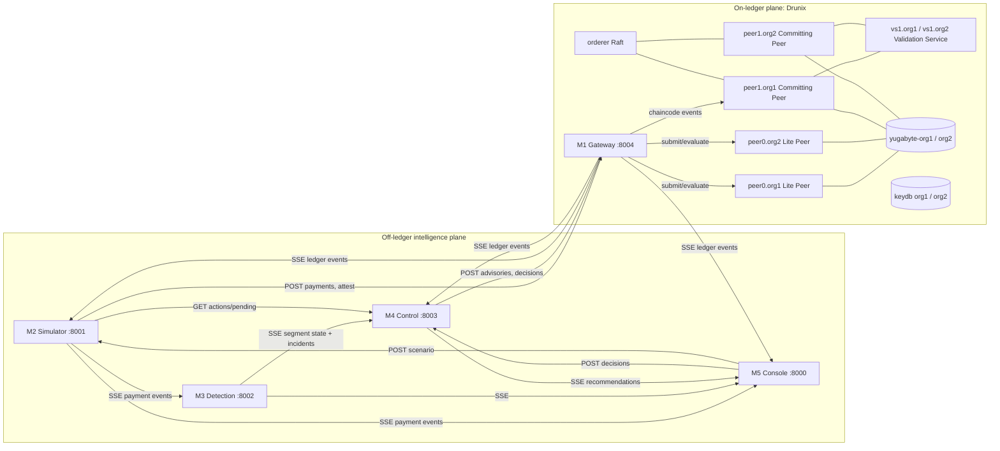
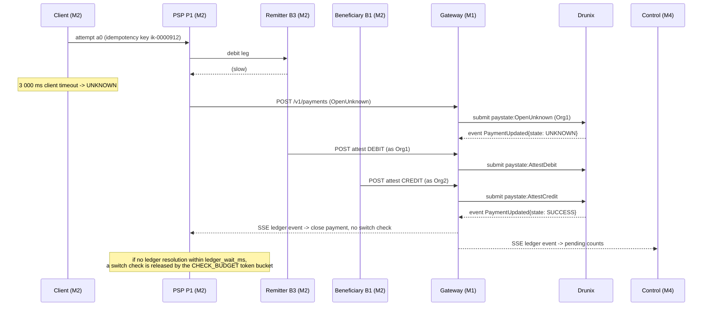
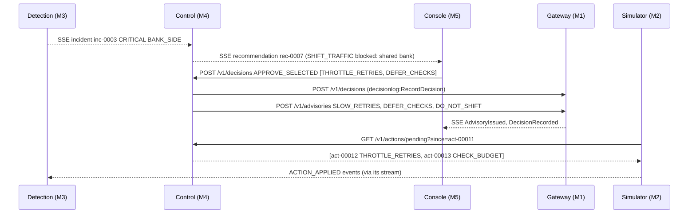

# 01 — System architecture, boundaries and run modes

## 1. Topology



## 2. Module boundaries (hard rules)

| Module | Owns exclusively | Never does |
|---|---|---|
| M1 Ledger | Drunix network scripts, chaincode `queueshield`, gateway service, mock gateway, ledger benchmark | Business decisions; reading payment events |
| M2 Simulator | Network model, clients, banks, switch, scenarios, ground truth, batch runs, arena orchestration, the in-sim ledger latency model for batch | Detection, recommendation, UI |
| M3 Detection | Features, baselines, D0–D3, surge gate, Fault Localizer, Cascade Forecaster, incident lifecycle | Actions, ledger writes |
| M4 Control | Check-budget computation, policy rules, recommendations, decision handling, action queue, advisory/decision writes, simulated operator | Detection math, UI, simulator internals |
| M5 Console | UI, scenario control, replay, compose, demo script, deck assets | Business logic beyond display; writing to the ledger directly |

Ground truth (which attempt truly committed, incident onset times) exists **only** inside M2 and in batch result files under `data/runs/`. M3 and M4 MUST NOT read ground truth at inference time; M3 MAY read it only in its offline training/evaluation scripts.

## 3. Ports, base URLs and environment variables

| Service | Port | Base URL (compose) | Key env vars |
|---|---|---|---|
| M5 console | 8000 | http://console:8000 | `SIM_URL`, `DETECT_URL`, `CONTROL_URL`, `LEDGER_URL` |
| M2 sim | 8001 | http://sim:8001 | `CONTROL_URL`, `LEDGER_URL`, `LEDGER_MODE=live|mock|model`, `DATA_DIR=/data` |
| M3 detect | 8002 | http://detect:8002 | `SIM_URL`, `DATA_DIR`, `MODEL_DIR=/data/models` |
| M4 control | 8003 | http://control:8003 | `DETECT_URL`, `LEDGER_URL`, `OPERATOR_MODE=human|auto`, `OPERATOR_DELAY_S` |
| M1 gateway | 8004 | http://ledger:8004 | `LEDGER_MODE=live|mock`, `DRUNIX_DIR`, `CHANNEL=mychannel`, `CHAINCODE=queueshield`, `TAT_SECONDS=120` |

All services read `QS_API_KEY`; every write endpoint requires header `X-QS-Key: $QS_API_KEY`. Reads are open on localhost.

## 4. The three run modes

| Mode | Who drives time | Transport | Ledger | Used for |
|---|---|---|---|---|
| **live** | M2 wall-clock × speed (1x, 2x, 4x) | SSE + REST between services | M1 live (Drunix) or M1 mock | Demo, integration |
| **mock** | Each module alone | Reads `contracts/fixtures/` or recorded streams | M1 mock | Day-1 development, unit/contract tests |
| **batch (lockstep)** | M2 tick-by-tick, as fast as possible | M2 calls M3 and M4 batch endpoints synchronously | M2's internal ledger latency model (`LEDGER_MODE=model`) | Arena, datasets, evaluation |

Batch mode never touches the real Drunix network: thousands of runs would exceed a laptop test network. M2's ledger model uses commit-latency parameters measured by M1's benchmark (`data/ledger_bench.json`).

### 4.1 Lockstep protocol (batch)

For each run: `POST detect/v1/batch/reset` and `POST control/v1/batch/reset` with the run id and `operator_mode=auto`. Then for each 5 000 ms tick:

1. M2 advances its simulation to `tick_sim_ms` and collects the events emitted since the last tick.
2. M2 → `POST detect/v1/batch/tick` with `DetectTickRequest` → receives `segment_state` (with incidents).
3. M2 → `POST control/v1/batch/tick` with `ControlTickRequest` (snapshot + ledger events from its model) → receives `ControlTickResponse` (recommendations, actions, advisories). The simulated operator inside M4 approves after `operator_delay_s`.
4. M2 applies actions whose `effective_from_sim_ms ≤ next tick`, and treats advisories as active network policy.

U0, U1 and U2 skip steps 3–4 (no QueueShield). U3 skips ledger events.

## 5. Life of an unknown payment (U4, live)



## 6. Life of an operator decision (live)



## 7. Identifiers

| Id | Format | Owner | Example |
|---|---|---|---|
| run_id | `r-<scenario>-<seed>-<universe>[-<suffix>]` | M2 | `r-S6-1-U4` |
| event_id | `<run_id>-<8-digit counter>` | M2 | `r-S6-1-U4-00000912` |
| payment_id | `p-<7 digits>` | M2 | `p-0000912` |
| attempt_id | `<payment_id>-a<n>` | M2 | `p-0000912-a1` |
| txnRef (ledger) | `<run_id>:<payment_id>` | M2 creates, M1 stores | `r-S6-1-U4:p-0000912` |
| idemKeyHash | `sha256:` + hex(sha256(idempotency_key + run_id)) | M2 | |
| incident_id | `inc-<4 digits>` per run | M3 | `inc-0003` |
| rec_id | `rec-<4 digits>` per run | M4 | `rec-0007` |
| action_id | `act-<5 digits>` per run | M4 | `act-00012` |
| advisory id | `adv-<5 digits>` per run | M4 | `adv-00001` |
| decision id | `dec-<5 digits>` per run | M4 | `dec-00001` |
| segment_id | `level:psp:bank` | M3 | `route:P1:B3`, `switch:*:*` |

## 8. Time

- `sim_ms` is integer milliseconds since run start on the simulator clock. Ticks are every 5 000 sim ms.
- In live mode M2 maps `sim_ms` to wall time with the speed factor; SSE messages carry `sim_ms` only.
- Ledger records carry both `*SimMs` (from M2) and unix seconds from the transaction timestamp. TAT is evaluated on the ledger in **wall seconds** (`TAT_SECONDS`, default 120) so it works without the simulator.
- Wall timestamps in logs are ISO 8601 UTC.

## 9. SSE rules (all streams)

- Format: `id: <monotonic integer>\nevent: <type>\ndata: <one JSON object>\n\n`.
- Servers MUST honour `Last-Event-ID` and replay from an in-memory ring buffer of at least 50 000 messages; older ids get event `reset` and the client re-reads `GET /v1/state`.
- Servers send a comment heartbeat `: hb` every 5 s.
- Clients reconnect with exponential backoff (0.5 s → 8 s, jittered) and resume with `Last-Event-ID`.

## 10. Failure isolation

| Failure | Behaviour |
|---|---|
| M1 down in live mode | M2 falls back to `LEDGER_MODE=model` for U4, emits a `degraded` health status; M5 shows "ledger offline"; never fakes ledger events |
| M3 down | M4 recommends nothing (no incidents); M5 shows detection offline |
| M4 down | M2 keeps the last applied actions; default budget stays POLICY_DEFAULT |
| M5 down | Nothing else changes; decisions cannot be made |
| A message fails schema validation | Dropped and counted; never crashes the receiver |
| Model error or >50 ms scoring | M3 sets `model_degraded`, falls back to rule signals, state DEGRADED_MONITORING for that segment |

## 11. Compose (owned by M5; reference)

```yaml
services:
  ledger:   { build: ./ledger/gateway, ports: ["8004:8004"], environment: [LEDGER_MODE, DRUNIX_DIR=/drunix, TAT_SECONDS=120, QS_API_KEY], volumes: ["./ledger/drunix:/drunix:ro"], network_mode: host }
  sim:      { build: ./sim, ports: ["8001:8001"], environment: [CONTROL_URL=http://localhost:8003, LEDGER_URL=http://localhost:8004, LEDGER_MODE, DATA_DIR=/data, QS_API_KEY], volumes: ["./data:/data"], network_mode: host }
  detect:   { build: ./detect, ports: ["8002:8002"], environment: [SIM_URL=http://localhost:8001, DATA_DIR=/data, MODEL_DIR=/data/models, QS_API_KEY], volumes: ["./data:/data"], network_mode: host }
  control:  { build: ./control, ports: ["8003:8003"], environment: [DETECT_URL=http://localhost:8002, LEDGER_URL=http://localhost:8004, OPERATOR_MODE=human, QS_API_KEY], network_mode: host }
  console:  { build: ./console, ports: ["8000:8000"], environment: [SIM_URL=http://localhost:8001, DETECT_URL=http://localhost:8002, CONTROL_URL=http://localhost:8003, LEDGER_URL=http://localhost:8004], network_mode: host }
```

`network_mode: host` is used because the gateway must reach the Drunix peers that the test network publishes on host ports. [VERIFY] on WSL2 Docker Desktop host networking; fallback: run the gateway outside compose with `npm start`.
